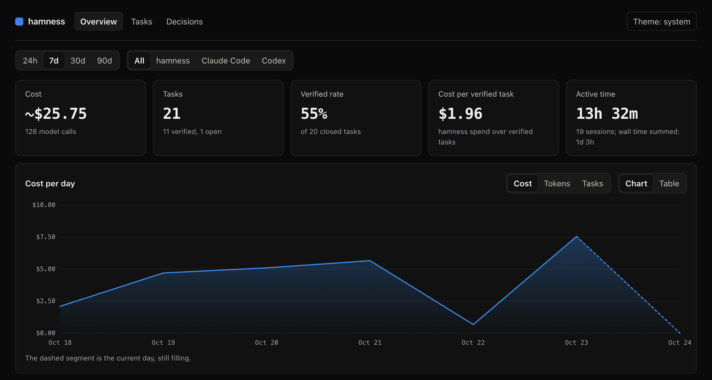

# hamness

An AI coding harness you can see into and trust.

- **Glass box:** a live side rail shows every agent, shell and check, with what it costs and which file it's on.
- **Proof:** a task is done only when hamness has checked the evidence itself: it re-runs the tests, reads CI, fetches the URL.
- **Outcomes:** every dollar is tied to a task, so you know what a verified change cost.

Runs on Bun. Multi-model (Claude by default). Reads your Claude Code setup (CLAUDE.md, AGENTS.md, skills, MCP servers, hooks) as it is.

**Status:** pre-release (v0.0.0). Expect rough edges; the design is in [the v1 spec](docs/superpowers/specs/2026-10-24-hamness-v1-design.md) and [the ADRs](docs/adr/).

## Contents

- [Quickstart](#quickstart)
- [The TUI](#the-tui)
- [Tasks and proof](#tasks-and-proof)
- [Safety: rules, modes and the judge](#safety-rules-modes-and-the-judge)
- [Claude Code compatibility](#claude-code-compatibility)
- [Stats, import and the dashboard](#stats-import-and-the-dashboard)
- [Commands](#commands)
- [Configuration and files](#configuration-and-files)
- [Development](#development)
- [License](#license)

## Quickstart

**1. Install.** You need [Bun](https://bun.sh) 1.4.4 or newer.

```sh
bun install -g github:hamzafer/hamness
```

This links `hamness` into Bun's global bin dir (`~/.bun/bin`; add it to your `PATH` if Bun says so). It is not on npm yet. From a clone, `bun install --frozen-lockfile && bun link` does the same.

A global install resolves dependencies afresh: it doesn't read hamness's `bun.lock` or `bunfig.toml`. Direct dependencies are exact pins either way, but their own dependencies take the newest version their ranges allow. For the exact locked set, install from a clone as above. To hold a global install to a minimum release age too, put `[install]` `minimumReleaseAge = 259200` in `~/.bunfig.toml`.

**2. Add a key.** Chat uses Claude through an Anthropic API key (Claude subscriptions are not used, see ADR 0011):

```sh
hamness keys set anthropic        # hidden prompt, saved with mode 0600
# or: export ANTHROPIC_API_KEY=...  (an env var wins over the key file)
```

**3. Check, then run.**

```sh
hamness doctor    # Bun, key, mode, daemon, data dir, gh, Claude Code setup
cd your/repo
hamness           # opens the chat; starts the daemon if needed
```

With no key, `hamness` prints a short setup instead of the chat. Ask for something small, like "add a test for the parser and make it pass". The agent opens a task, does the work, proves it with a command hamness re-runs, and the rail shows the task **verified**.

## The TUI

`hamness` opens the chat for the current directory. The session lives in a background daemon: closing the TUI never stops it, reopening it in the same directory reattaches, and after a daemon restart the directory's last session resumes with its transcript.

The **side rail** on the right shows the current task (goal, outcome, evidence passed of checked; unverified in red), one row per agent (status, current tool and file, elapsed time, tokens, cost), a row per proof check (what hamness is re-running or reading, then how it ended), the context gauge and the session cost. Background shells have no rows yet: Pi's `bash` has no background mode (ADR 0019).

| Key | Does |
|---|---|
| Enter | send the prompt |
| Shift+Enter or Ctrl+J | new line in the prompt (Shift+Enter needs a terminal with the kitty keyboard protocol) |
| Esc | stop the running prompt (deny, when an approval shows; close `/help`) |
| y / a / n | answer an approval: allow once, allow always, deny |
| Ctrl+R | the side rail full screen, and back |
| Ctrl+C | leave the TUI (the session keeps running) |

| Command | Does |
|---|---|
| `/task <goal>` | open a task yourself |
| `/override [reason]` | accept the open or unverified task without proof |
| `/abandon [reason]` | drop the open task |
| `/model [provider/id]` | switch model; alone, it opens a picker |
| `/judge resume` | turn a paused judge back on |
| `/help` | list these commands and keys |

## Tasks and proof

Work happens in **tasks** (ADRs 0004, 0005, 0012, 0019). The agent opens one with `task_start`, attaches evidence with `prove` and closes it with `task_done`. hamness checks each piece of evidence itself; the agent can't mark anything passed:

| Evidence | Passes when |
|---|---|
| `command` | hamness re-runs it in the session's dir and it exits 0 (and, for a test run, tests ran) |
| `file` | the file is inside the session's dir, exists, is not empty and was written during the task |
| `url` | after a safety check, a fetch returns 2xx (same-host redirects only, no private addresses) |
| `ci` | every check on the PR or commit passed (read through `gh`), for this repo and code in HEAD's history |

A task is **verified** only when its latest evidence passed after its last file edit; otherwise it closes **unverified**. Only you can accept it anyway (`/override`) or drop it (`/abandon`). A turn with no task open gets its own task, which is dropped at the end if it had no failed evidence and no file edits. Cost, tokens and time roll up to the task, along with its branch and, from CI evidence, its PR and commit.

**What counts as proof** (ADR 0019):
- Commands that can't prove anything are refused: `echo`, `true`, `exit 0`, read-only commands like `cat` or `git status`, `|| true`, `;`, `&`, `$VAR`, `--help`. Join steps with `&&`; pipes run with `pipefail`.
- A re-run asks two things. **May it run?** The same answer a `bash` call with that command gets: your rules, then the judge in auto mode, then you (`yolo` runs it). **Does it count?** Only when it is on the **proof command list**: built-in test, build, lint and typecheck commands (`bun test`, `npm test`, `npm run build`, `pnpm test`, `cargo test`, `go test`, `pytest`, `make test`, `tsc`, ...), your `proof.commands`, and the project's `proof.commands` once you trust the repo. Anything else asks "count `X` as proof?" in every mode, `yolo` included; "always" adds it to your list. To let `bun test` run unasked in ask mode, add a bash allow rule for it. A pass after the agent edited what the command runs (`package.json`, a Makefile, a test config) is weak and does not verify alone.
- A file the agent wrote itself with `write` / `edit` is **weak** evidence: it never verifies a task alone.

```json
{ "proof": { "commands": ["just verify *"], "allowPrivateUrls": false } }
```

`allowPrivateUrls` (your config only) lets `prove url` reach a local dev server.

## Safety: rules, modes and the judge

Every tool call passes **allow / ask / deny rules** before it runs (ADR 0006). The defaults:

- Reads are allowed, except `.env` files and secrets (`~/.ssh`, `~/.aws`, keys). A recursive read (`grep -r`, `rg`, `find`, the grep and find tools) over a folder that holds them asks, and so does one that reads contents (`grep -r`, `rg`, `ag`, the grep tool) when the files it would open include a denied one, such as a repo's `.env` (rg and the grep tool skip what `.gitignore` ignores, so an ignored `.env` does not count for them). On a case-insensitive filesystem these paths match in any case.
- Writes inside the session's dir are allowed, except `.env`, `.git`, `.hamness`, `.claude/settings*.json` and `.mcp.json`, which ask. When the session runs in your home folder or `/`, writes there ask too.
- `bash` asks, except a short read-only list (`ls`, `cat`, `grep`, `git status`, `git diff`, `git log`, ...). `rm -rf` and force pushes ask; `sudo` and `curl | sh` are denied, also when run by path (`/usr/bin/sudo`).
- Compound commands (`&&`, `;`, `|`, subshells, `$(...)`, `${x:-$(...)}`) are checked part by part, and the strictest part wins. Globs are expanded and every match is checked (`cat ~/.ss?/id_rsa` is denied).
- Paths are resolved the way Pi's tools open them (`file://` URLs, `~`, `@`, Unicode spaces).

**Modes** decide what happens to calls no rule decides (user config only):

| Mode | Undecided calls |
|---|---|
| `auto` (default) | the judge decides; it asks you when unsure |
| `ask` | you decide |
| `yolo` | allowed, with a red banner that says so; `ask` rules are skipped too. Deny rules (the defaults and yours) still block direct references to secrets, and a call hamness can't see past (a recursive search over a folder holding secrets, a heredoc, a path in a variable, a glob too big to check) still asks. yolo can't see inside scripts and interpreters (`python3 -c`, `xargs`, `tar`). |

**The judge** (auto mode) is Claude Haiku 5.5, keyed like chat. It sees the call (secrets redacted) as untrusted data and answers `allow`, or `ask` with a reason and a risk category. An error, an 8 s timeout, a refusal or an answer that does not parse means you are asked. Its spend is capped per day (default $1); after 3 asks in a row it pauses for the session until you type `/judge resume`. With no Anthropic key it is off and undecided calls ask you. The TUI header shows its state.

**Approvals** show above the input: `y` allows once, `a` allows always (saves the suggested pattern to the project config), `n` or Esc denies. No answer before the timeout (15 minutes) is a deny. Every decision is stored with its source (`rule`, `judge`, `hook`, `user`, `mode`) and reason; `hamness audit` lists them.

Rules go under `safety` in your config or the project's, as globs where the last match wins. A project rule can allow what nothing else decides but never loosens an `ask` or `deny`, and a project's allow rules apply only once you trust the repo (see [Repo trust](#repo-trust)); its ask and deny rules always apply. Mode, timeout and judge settings are read from your config only:

```json
{
  "safety": {
    "mode": "auto",
    "approvalTimeoutSec": 900,
    "permission": {
      "bash": { "npm test *": "allow", "npm publish *": "deny" },
      "{write,edit}": { "$CWD/dist/**": "deny" },
      "mcp__github__*": "ask"
    },
    "judge": { "model": "claude-haiku-5-5", "dailyBudgetUsd": 1, "timeoutSec": 8 }
  }
}
```

## Repo trust

A repo can bring things that loosen safety or run code: allow rules and proof commands in `.hamness/config.json`, Claude Code hooks in `.claude/settings*.json`, and MCP servers in `.mcp.json`. None of them take effect until you trust the repo (ADR 0020):

```sh
hamness trust --show   # what this repo brings, and what is new or changed since you trusted it
hamness trust          # trust it all, as it is now
hamness trust --revoke # forget it
```

Each item is trusted as it is, so a hook, rule or server that is added or edited later waits until you trust again. The agent's own writes to those files ask first. Trust is kept in your config, never in the repo, and a subagent's worktree shares its repo's trust.

## Claude Code compatibility

hamness reads your Claude Code setup as it is and never changes it (ADRs 0008, 0016, 0017). `CLAUDE_CONFIG_DIR` picks another config dir, as in Claude Code. `hamness compat` shows what a session in this dir picks up.

- **Instructions:** managed `CLAUDE.md`, `~/.claude/CLAUDE.md` and `~/.claude/rules/`, then `CLAUDE.md`, `.claude/CLAUDE.md`, `.claude/rules/` and `CLAUDE.local.md` in each folder from `/` down to the session's dir. `AGENTS.md` loads when none of those exist (or always, with Claude Code's `claude-md-and-agents-md` setting). `@path` imports expand; a repo file can't import from outside the repo.
- **Skills:** `<name>/SKILL.md` in `~/.claude/skills`, `<data dir>/skills`, `.claude/skills` up to the repo root and `.hamness/skills`. The prompt lists names and descriptions; the `skill` tool loads a body. Fields that would loosen safety or switch models (`allowed-tools`, `model`, ...) are not honored.
- **MCP servers:** user and local servers from `~/.claude.json` start. A repo's `.mcp.json` servers wait until you trust the repo (`hamness trust`). Tools are named `mcp__<server>__<tool>` and pass the safety rules. stdio and HTTP only.
- **Hooks:** `command` hooks for SessionStart, UserPromptSubmit, PreToolUse, PostToolUse and Stop run with Claude Code's matchers, JSON input and output, exit code 2 and timeouts. A PreToolUse deny is final; an allow skips the ask but never beats a rule deny. Hooks in managed settings and `~/.claude/settings.json` always run; a project's (from `.claude/settings.json` and `settings.local.json` at the repo root and in the session's dir) run as you trusted them with `hamness trust`.
- **Subagents:** the agent can start subagents in the background (`agent_start`, `agent_status`, `agent_wait`), optionally on another model or in their own git worktree (`<repo>.hamness-worktrees/`, branch `hamness/<name>-<id>`). Each passes the same rules, shows as a rail row, and its cost counts toward the parent's task. `hamness worktrees` lists them; `--prune` removes finished ones (ADR 0015).

## Stats, import and the dashboard

```sh
hamness import       # read Claude Code and Codex history (read-only, incremental)
hamness stats        # today, 7 and 30 days: tasks, verified rate, cost per verified task, models, tools
hamness stats --range 7d --source hamness --json
hamness dashboard    # the same in the browser (--no-open prints the link)
```

Imported history has no tasks, and its cost is estimated from token counts. The dashboard is served by the daemon on `127.0.0.1` (started if needed): KPI tiles, one chart over time (cost, tokens or tasks, with a table view), the task list with each task's evidence, and the safety decisions, filtered by range and source. The link carries the daemon's token after `#`, which the browser never sends to a server (ADR 0018).



## Commands

`hamness --help` lists them and `hamness <command> --help` shows each one's options.

| Command | Does |
|---|---|
| `hamness` | chat in the terminal (same as `hamness tui`) |
| `hamness doctor` | check the setup and say what to fix |
| `hamness keys set <provider>`, `hamness keys list` | store an API key; show which providers have one (never the key) |
| `hamness login openai`, `hamness logout <provider>` | sign in with a ChatGPT plan; remove a sign-in |
| `hamness models [--all]` | the models you can switch to, with prices |
| `hamness status`, `hamness stop` | is the daemon running; stop it (restart it this way after adding a key) |
| `hamness daemon` | run the daemon in the foreground |
| `hamness stats`, `hamness dashboard`, `hamness import` | see [Stats](#stats-import-and-the-dashboard) |
| `hamness audit [--session <id>] [--json]` | recent safety decisions and why |
| `hamness trust [--show or --revoke]` | trust a repo's allow rules, proof commands, hooks and MCP servers |
| `hamness compat [approve or revoke]` | the Claude Code setup found here; approve project MCP servers |
| `hamness hooks [trust]` | the Claude Code hooks found here (`trust` is `hamness trust`) |
| `hamness worktrees [--prune]` | subagent worktrees |

Errors are one line that says what to do; set `HAMNESS_DEBUG=1` to also print the stack trace.

## Configuration and files

Everything hamness keeps is in its **data dir**: `~/Library/Application Support/hamness` on macOS, `$XDG_DATA_HOME/hamness` (default `~/.local/share/hamness`) on Linux, or `HAMNESS_HOME`.

| Path | Holds |
|---|---|
| `<data dir>/config.json` | your config: `safety` (mode, rules, judge), `proof` (proof commands, private URLs) and `trust` (what you trusted per repo) |
| `<repo>/.hamness/config.json` | the project's rules ("allow always" writes here) and proof commands |
| `<data dir>/keys.json` | API keys (mode 0600; env vars win) |
| `<data dir>/hamness.sqlite` | sessions, tasks, evidence, model calls, decisions, imported history |
| `<data dir>/pi/` | Pi's logins, model list and session files |
| `<data dir>/daemon.log` | output of a daemon the TUI started |

| Env var | Does |
|---|---|
| `ANTHROPIC_API_KEY`, `OPENAI_API_KEY`, ... | provider keys |
| `HAMNESS_MODEL` | model for new sessions, as `provider/id` (default `anthropic/claude-opus-5-5`) |
| `HAMNESS_HOME` | the data dir |
| `HAMNESS_PORT` | the daemon's API port (default 7357; 0 picks a free one) |
| `HAMNESS_DEBUG` | `1` prints stack traces with errors |
| `CLAUDE_CONFIG_DIR` | Claude Code's config dir to read (default `~/.claude`) |

Model prices live in `src/models/price-data.ts`, with their sources and the date they were checked; each model call records its own model and cost.

## Development

```sh
bun install
bun test            # unit, integration and the end-to-end story (test/e2e.test.ts)
bun run typecheck   # strict TypeScript
bun run lint        # Biome (bun run format fixes)
bun src/cli/main.ts # run hamness from the checkout
```

Dependencies are pinned to exact versions, and `bunfig.toml` sets `[install] minimumReleaseAge = 259200` (3 days): Bun won't resolve a version published more recently than that, so a hijacked release has time to be caught before it lands here. Every version in `bun.lock` was at least 3 days old when it was locked. Bump a pin only to a version that has been out 3 days.

## License

MIT
